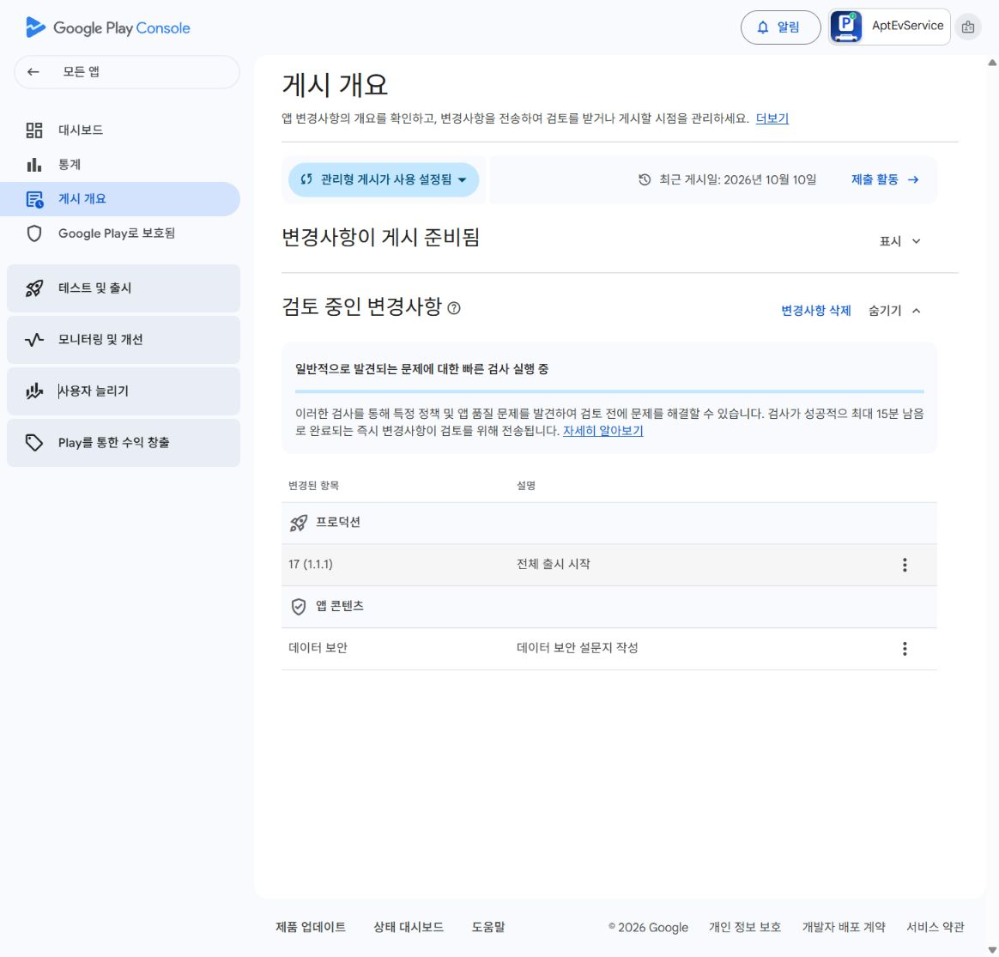

# 출차 요청 운영 배포 기록

기준: 2026-10-10. 사용자 승인으로 앱·웹·서버 배포 및 Firebase 연결을 진행했다. 기존 사용자 변경을 보존했으며 Git 커밋·push는 수행하지 않았다.

## 운영 적용

- Vercel 운영 URL: https://apt-ev-charging.vercel.app
- 배포: https://apt-ev-charging-7a5q80a6b-polkolpk-7667s-projects.vercel.app
- Neon 운영 DB에 `sql/departure-requests.sql`을 트랜잭션으로 적용했다. 적용 전후 기존 주차 상태 데이터와 수정 시각이 동일하다. 요청 이력과 세션별 푸시 토큰 테이블 및 원자적 요청 저장 함수를 확인했다. 관련 회원 완전 삭제 시 요청 이력을 제거하는 외래 키를 포함한다.
- Firebase 프로젝트 `aptrequest`에 Android 패키지 `apt.ev.service`를 연결했다. 전용 FCM 발송 계정의 자격증명은 Vercel production 비밀 환경 변수에 저장했다. 서비스 계정 키는 Git·앱 빌드에 포함하지 않았다.
- Vercel Hobby 함수 제한에 맞춰 새 API 두 개를 기존 profile 함수로 연결했다. 공개 URL은 `/api/departure-requests`, `/api/push-tokens`를 유지한다. 잘못된 내부 분기 값은 400으로 거절한다.
- 개인정보처리방침에 출차 요청, 선택적 알림, 설치 식별자, FCM 처리를 반영했다. Play 데이터 보안 신고에 기기 또는 기타 ID를 선택적 수집·앱 기능 용도로 추가했다.

## Android

- 버전 `1.1.1+17`, 운영 서버와 Android Firebase 설정을 사용해 release AAB를 빌드했다.
- 파일: `D:/Temp/AptEvService-1.1.1-17.aab`
- SHA256: `0E717CC6E450A79EA129FDD96609D2028FC1E87DB02292C94EAF6D88D268B206`
- bundletool 검증 및 서명 검증 통과. 실제 manifest에서 versionCode 17, target SDK 36, 알림 권한 포함, 광범위 사진·동영상·저장소 권한 없음 확인.
- Play 프로덕션 릴리스 17 업로드 및 저장 완료. 심사 제출 상태는 아래 최종 상태에 기록한다. 기존 스토어 버전은 16이다.
- 다음 빌드용 Firebase dart-define 파일을 로컬에 보관하고 Git에서 제외했다. Fastlane은 이 파일을 읽도록 수정했지만 Windows에 Ruby가 없어 실행하지 않았다. 이번 AAB는 Flutter 명령으로 직접 빌드했다.

## 확인한 범위

- Flutter 전체 테스트 109개 및 정적 분석 통과는 구현 검증 기록 참조.
- 최종 Node 22 서버 테스트 35개 통과. 실제 SQL을 PGlite에서 실행하는 검증, 계정 삭제 연쇄 정리, 배포 라우팅 및 잘못된 분기 거절을 포함한다.
- 운영 공개 조회 200, 인증 없는 출차 조회 401, 지원하지 않는 메서드 405, 잘못된 분기 400 및 `no-store` 확인.
- FCM 서비스 계정 인증 및 Messaging API 접근 확인. 실제 휴대폰 토큰으로 알림을 전달한 검증은 수행하지 않았다.

## 남은 확인

- 두 Android 휴대폰으로 알림 허용/거절, 종료 상태 수신, 요청 차량 표시, 알림 선택, 로그아웃·계정 전환 검증.
- Neon 독립 연결 간 동시 요청 검증. 오프라인 SQL 테스트가 이를 대체하지 않는다.
- iOS APNs·서명·기기 설정과 macOS/Xcode 빌드·배포. Windows에서는 iOS 배포를 수행하지 않았다.
- Google 심사 승인 후 관리형 게시에서 실제 게시가 필요하다.

## 전체 연동 구조

[앱·서버 전체 SVG](../architecture/generated/app-server-integration.svg) · [Mermaid](../architecture/app-server-integration.mmd) · [JSON 색인](../architecture/app-server-integration.index.json)

## Play 최종 상태

프로덕션 `17 (1.1.1)`과 데이터 보안 변경사항 두 개의 검토 전송을 완료했다. Play Console에서 **검토 중인 변경사항**에 두 항목이 표시되는 것을 확인했다. 화면은 사전 빠른 검사를 진행 중이며 검사 성공 후 Google 검토로 전송된다고 안내한다. 새 버전이 게시된 상태는 아니다. 관리형 게시가 켜져 있으므로 심사 승인 후 별도 게시가 필요하다.

## 배포 실패 이메일 확인 — 2026-10-11

- 이메일의 실패 시각 2026-10-10 14:38 UTC는 한국 시각 23:38이다. 실패 배포는 `apt-ev-charging-mt1840dw0-polkolpk-7667s-projects.vercel.app`이며, 이후 수정 전 시도에 해당한다.
- Vercel 조회에서 23:44:53 KST에 생성된 운영 배포 `dpl_2hezoa1FtKcBRW8fS9ZRQsKuNCZF`가 Ready이고 운영 도메인 `apt-ev-charging.vercel.app`의 별칭으로 연결된 것을 재확인했다.
- 공개 조회 GET 200, 인증 없는 출차 조회 GET 401, 푸시 토큰의 지원하지 않는 GET 405, 잘못된 분기의 DELETE 400을 운영 주소에서 재확인했다. 실패한 배포가 현재 운영 배포를 대체하지 않았다.
- 로컬 수정 및 `.vercelignore`는 아직 Git에 커밋되지 않았다. 이후 Git 기반 자동 배포에는 현재 운영에 적용한 관련 변경을 함께 반영해야 한다. 이번 확인에서는 추가 커밋·push나 불필요한 재배포를 수행하지 않았다.
