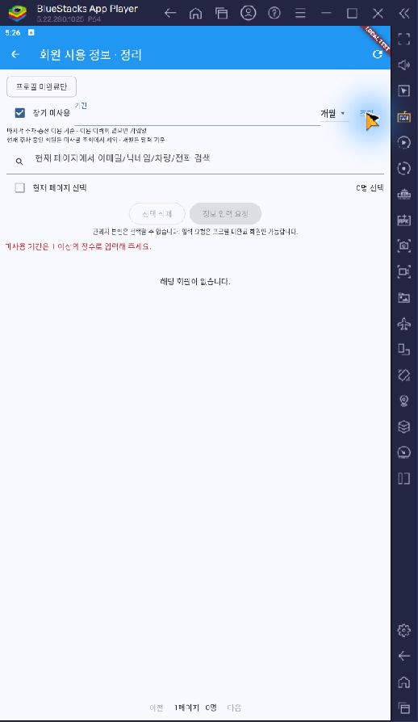

# 관리자 회원 정리 검증·배포 (2026-10-14)

사용자가 확인한 기준: 마지막 주차·충전 이용일로 미사용을 조회하고, 이용 이력이 없는 회원은
가입일로 판단한다. 앱 회원 삭제 후 같은 Google 이메일 로그인은 신규 가입·승인으로 진행한다.
Google 계정 자체는 삭제하지 않는다.

## 구현

- 회원 승인 화면의 `회원 정리`, 회원 사용 정보 메뉴에서 공통 관리 화면에 진입한다.
- 프로필 필수 정보(닉네임·차량번호·전화번호) 누락 필터, 일/달력 개월 미사용 조회,
  서버 필터 후 50명 페이지 조회, 현재 페이지 검색·선택과 선택 삭제를 지원한다.
- 현재 차량 등록 회원은 미사용 조회에서 제외하고, 모든 관리자와 본인은 삭제할 수 없다.
- 삭제 대상·범위를 확인한 후 앱 가입 정보·세션·주차/대화/알림·관련 개인 기록을 원자적으로 삭제한다.
- 미입력 회원에게 기본 안내와 최대 2000자의 추가 메시지를 검토한 후 저장한다.
  앱 내 저장 건수와 기기 토큰별 FCM 접수/실패 건수를 구분한다.
- 프로필 화면은 승인 대기 회원 본인의 관리자 안내도 조회한다. 안내 조회 실패가 정보 입력을 막지 않는다.
- 삭제 직후 재가입 또는 지연 저장이 옛 개인 정보·승인을 복원하지 않도록 서버 가입 세대를 검사한다.
  Flutter는 서버 `ownerInstanceAt`를 파싱·복사·수정 저장할 때 보존한다.

서버 계약 및 마이그레이션: `D:/vsCodeProg/APT-Prj/docs/member-management-api.md`,
`D:/vsCodeProg/APT-Prj/sql/member-management.sql`.

## 검증

- `flutter analyze --no-fatal-infos --no-pub`: **No issues found**.
- `flutter test --no-pub`: **131개 통과**. `D:/Temp/apt-member-flutter-final.log`.
- 서버 `npm test`: **56개 통과** (회원관리 21 + 기존 35). `D:/Temp/apt-member-node-final.log`.
- 별도 읽기 전용 코드 리뷰: 삭제/재가입 경합·마스킹·저장 최종 응답·기존 승인 API 보호 확인,
  집중 PostgreSQL 테스트 21개 재실행 통과, 남은 P1/P2 발견 없음.
- BlueStacks Android 9/API28에서 Computer Use로 로컬 관리자 UI를 확인했다.
  `.invalid` 가짜 회원만 사용하며 네트워크 연결 없는 fixture다.
  미입력 2명 필터·전체 선택, 기본/추가 메시지 입력과 최종 확인·저장, 한 명 선택 삭제 후 목록 감소,
  30일 및 2개월 조회에서 최근 사용자/현재 주차자 제외, 잘못된 기간 입력 차단을 확인했다.
- 320/360 폭과 키보드가 열린 화면의 overflow는 sliver 스크롤로 수정하고 위젯 테스트로 검증했다.
- 실제 운영 회원 삭제·안내 발송 및 실제 Google 재로그인/OS 실기기 검증은 실행하지 않았다.

## 운영 서버 적용

- 연결된 Vercel 프로젝트 `apt-ev-charging`의 운영 환경 설정으로 대상 DB를 확인했다.
- 새 서버를 `--prod --skip-domain`으로 먼저 빌드해 준비했다.
- 명시적 마이그레이션을 트랜잭션에서 실행했고, 회원 수 **67 → 67**, 기존 주차 정보 동일을
  커밋 전에 비교했다. 달라졌다면 롤백하는 runner를 사용했다. 차량/연락처 정보는 로그에 출력하지 않았다.
- 운영 주소를 새 배포에 연결했다:
  `apt-ev-charging-e8iervni8-polkolpk-7667s-projects.vercel.app`.
- 운영 익명 조회 확인: `/api/public-dashboard` 200/ok,
  `/api/admin-members` 403, `/api/member-notices` 401. 비회원에게 개인 목록이 노출되지 않는다.
- 이 배포는 실제 회원 삭제나 안내 발송을 실행하지 않았다. 임시 운영 환경 파일은 정리했다.

## 앱 출시 준비

- 정상 진입점 `lib/main.dart`, 운영 API/Firebase 설정, 난독화 release AAB **1.1.3+19** 빌드 성공.
- package `apt.ev.service`, versionCode19, minSdk24/targetSdk36.
- bundletool validate 및 jarsigner 서명 검증 통과. 자체 인증서 chain/timestamp 안내가 있다.
- [AAB](../../AppBundle/releases/2026-10-14-v1.1.3-19/AptEvService-1.1.3-19.aab): **52,424,425 bytes**.
- SHA256 `A8C2B6AF37BD4CC4B2D425A9C04BA110AD97912779B6FF4A62071057E2D0F905`.
- Play Console 새 버전 업로드는 **미완료**. Chrome 확장 연결이 끊겨 기존 탭과 새 탭 연결 모두 실패했다.
  재연결을 요청했으며 별도 Play API 서비스 계정 파일도 없다. 이전 제출 버전18의 최신 심사 상태는 재조회하지 못했다.
  재연결 후 버전19 업로드·검토 전송과 Google 승인 이후 게시를 이어가야 한다.
