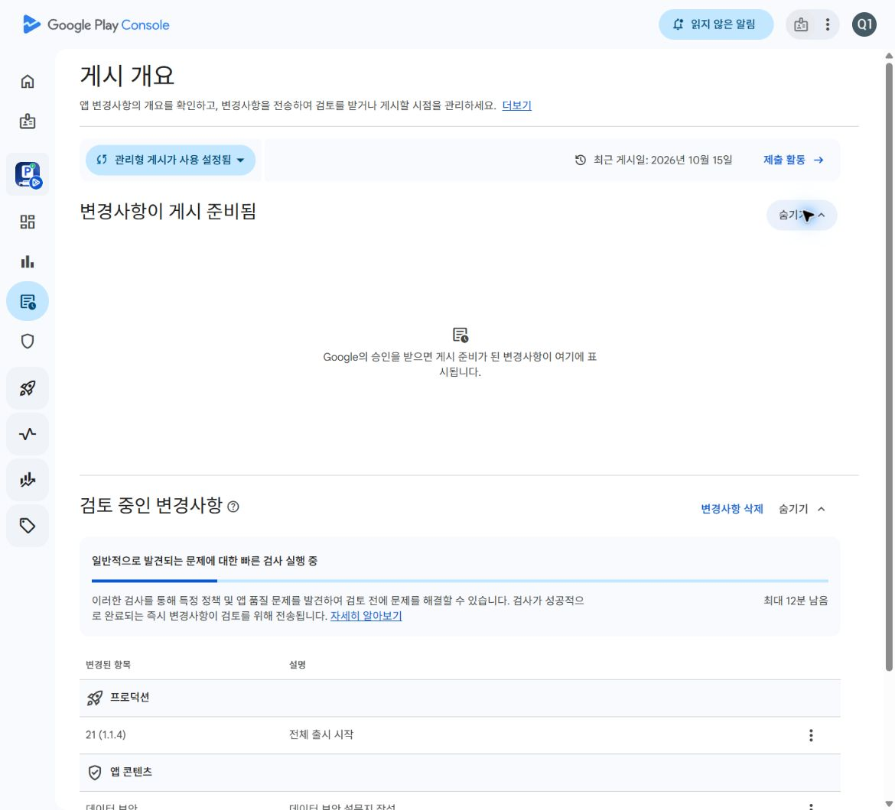
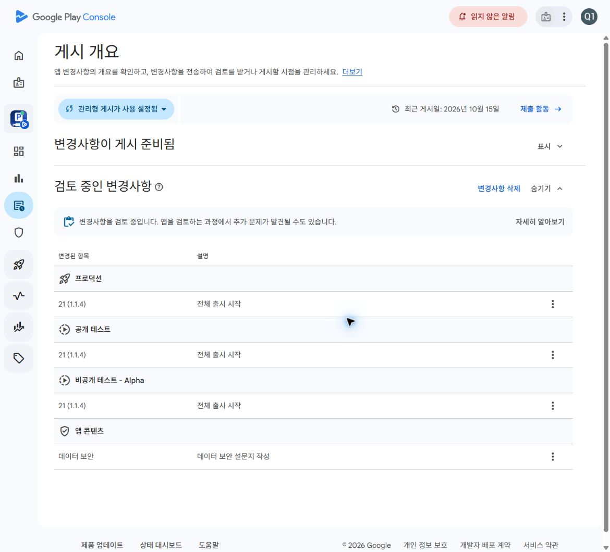

# 1.1.4+21 Android 릴리스 검증

## 변경과 목적

`android.hardware.microphone`을 `required=false`로 명시했다. 음성통화는 선택 기능이므로 `RECORD_AUDIO` 권한으로 인해 마이크가 없는 기기의 기존 주차 기능 설치까지 제한하지 않게 한다. 버전 코드는 Play에 업로드된 20과 구분하기 위해 21로 올렸다. 20은 이번 게시 대상이 아니다.

개인정보 동의 화면은 실제 서버 동작에 맞춰 OCR 후보·상태, 사진 삭제 경로, 게시글·신고별 보관 기준을 구분한다. API와 동의 버전 1.3은 유지한다. 로컬 검증 fixture의 음성 capability는 명시적으로 비활성 응답을 반환하며 프로덕션 네트워크나 마이크를 사용하지 않는다.

## 빌드 설정

Flutter 3.41.6 / Dart 3.11.4, 기존 업로드 서명을 사용한다. 기존 Firebase 환경 파일과 Google 클라이언트 기본 설정을 유지하며 API는 `https://apt-ev-charging.vercel.app`, 환경은 `prod`다. 비밀 값과 서명 설정 내용은 이 문서에 기록하지 않는다.

Gradle heap 1024MB, worker 1개, 병렬 빌드 비활성, Kotlin in-process 설정으로 순차 빌드한다. `TEMP`/`TMP`는 ASCII 경로를 사용하고 `DEBUG`를 비운다. 난독화와 ABI별 Dart symbols를 생성한다.

## 검증 상태

서명 AAB 빌드는 종료 코드 0으로 완료했다(604.9초). 산출물은 `AppBundle/releases/2026-10-21-v1.1.4-21/apt-ev-service-v1.1.4-21.aab`, 크기는 84,902,707바이트다.

SHA256: `207a8a7fdb4531da22952183af62314f18b403e32826c3ed603dad99cc5b9284`

bundletool 검증과 jarsigner 서명 검증을 통과했다. 실제 20 AAB와 인증서를 비교해 같은 업로드 서명임을 확인했다. 인증서 SHA256은 `95:BE:C2:53:15:AD:1C:A4:7D:79:03:9E:33:E7:CB:1C:59:E6:96:F0:95:BD:AE:3B:70:9C:51:BE:D3:F2:6F:A8`이다. 실제 번들 manifest는 패키지 `apt.ev.service`, 버전 `1.1.4+21`, minSdk 24, targetSdk 36이며 마이크 기능은 `required=false`다. 전화·연락처·광범위 사진/저장소 권한은 없다. 64비트 네이티브 라이브러리 10개의 ELF LOAD 정렬과 번들의 `PAGE_ALIGNMENT_16K`를 확인했다.

전체 `flutter analyze --no-pub --no-fatal-infos`는 종료 코드 0, 문제 없음으로 완료했다(172.5초). 이전 전체 회귀 187개 통과와 최종 변경 후 집중 테스트 20개 통과는 별도 실행이며 합산해 전체 회귀로 표시하지 않는다. 로그는 릴리스 폴더의 `analyze.log`, `flutter-test-prior-full-187.log`, `flutter-test-final-focused-20.log`에 보관했다. 정리된 빌드 로그, bundletool 출력, manifest, 인증서 비교, `native-alignment.json`, `release-metadata.json`, R8 `mapping.txt`와 ABI별 Dart symbols 3개도 함께 보관했다.

이전 20의 전체 회귀 결과는 [20 검증 기록](RELEASE_1.1.4_20_2026-10-21.md), 에뮬레이터 실행 결과는 [BlueStacks 기록](BLUESTACKS_RELEASE_2026-10-21.md)을 따른다. 21의 Play 업로드·지원 기기 변경·심사 제출 상태는 별도로 확인하며, 이 빌드 검증 시점에는 게시 완료를 주장하지 않는다. TURN은 비활성이며 실제 기기 두 대의 음성통화와 iOS 실행은 미검증이다. 로컬 기기 확인용 debug 재서명 APK는 원본 AAB와 구분하며 배포 AAB를 변경하지 않는다.

연결된 BlueStacks `127.0.0.1:5555`용 분할 APK는 `D:/Temp/apt-bluestacks-v21.apks`에 준비했다(SHA256 `be0f805bd4b0647303d6f564209cf2b840b5ae095ddedb0bfc231893af088c8d`). 실제 base APK의 패키지·버전 21·마이크 선택 기능과 서명을 검증했으며, 이전 로컬 20 APK와 debug 인증서가 일치한다. 이 준비 작업은 설치를 수행하지 않았다. 최종 21 설치·실행 결과는 BlueStacks 기록에서 별도로 확인한다.

## 최종 21 실행 및 Play 사전 검토

준비 이후 bundletool 설치가 종료 코드 0으로 완료됐고 기존 앱 제거·데이터 삭제 없이 code21로 업데이트했다. 설치 완료 후 재기동은 `Status: ok`였으며 로그인, 게스트 공개 목록과 B1 지도가 표시됐다. PID 4453의 관찰 로그에서 `E/flutter`, `FATAL EXCEPTION`, `ANR in`, `MissingPluginException`, `UnsatisfiedLinkError` 필터 결과는 0건이었다. 설치 종료 전 먼저 실행했던 PID 4158은 설치 과정의 `stop apt.ev.service` 이벤트 후 종료됐으므로 정상 실행 검증은 설치 완료 후 PID 4453을 기준으로 한다.

- [최종 로그인](bluestacks-20261021/release21-login.png), [게스트 조회](bluestacks-20261021/release21-guest-list.png), [지도](bluestacks-20261021/release21-map-b1.png).
- Play Console은 서명된 21 AAB를 수신했다. 20은 이번 출시에서 제외했으며 아티팩트 라이브러리에 보존한다.
- 20 초안의 지원 기기 제외 20종(전화 6·태블릿 11·TV 3)은 21에서 0종으로 해소됐다. 전화 12,375·태블릿 6,788·TV 7종과 나머지 기존 폼 팩터의 지원 수가 유지된다. Console 기능 수는 7로 표시되지만 실제 지원 기기 감소는 없다.
- 남은 경고 1개는 APK 다운로드 크기 증가다. Console 신규 설치 추정 29MB, 이전 대비 +12.5MB이며 차단 오류는 표시되지 않았다.
- [21 호환성 검토 화면](bluestacks-20261021/play-v21-compatibility-restored.jpg). [데이터 보안 신고](PLAY_DATA_SAFETY_2026-10-21.md)는 저장됐으며 최종 검토 전송 상태는 아래 배포 결과에 기록한다.

## 운영 전환 및 Google 검토 요청 결과

운영 주소 `https://apt-ev-charging.vercel.app`를 `dpl_FLZLaE3zbhejK4NpU4gL1PXZ9MhF`로 승격했고 canonical 조회가 정확히 해당 READY 배포를 가리키는 것을 확인했다. 공개 dashboard 200, 비로그인 board·charger-reports·parking-voice 401, 개인정보·계정 삭제 안내 200을 확인했다. 공개 응답에 비어 있지 않은 차주 이메일·연락처가 없는지도 검사했다. 마지막 추가 변경은 ML Kit SDK 진단 처리와 계정 삭제 안내 문구 정합성이며 DB·회원 정리·환경 설정 변경을 수행하지 않았다. 기존 롤백 참조는 `dpl_EW12gK6D42nAV5gr5zQfAkJBYbYw`다. 상세는 서버 저장소 `docs/backend-cutover-2026-10-21.md`를 따른다.

전환 후 최종 21 앱의 게스트 목록에서도 새로고침이 정상 표시됐다. [운영 전환 후 앱 조회](bluestacks-20261021/release21-production-refresh.png).

처음 프로덕션 21과 데이터 보안 2개를 검토 전송한 뒤 실제 사전 검사에서 활성 구버전 14의 사진·동영상 권한이 차단됐다. 공개 테스트의 HALTED 16에서 14가 제공되는 경로와 비공개 Alpha의 14가 원인이었다. 기존 21 AAB를 다시 검사해 광범위 사진 권한이 없고 위 SHA256이 유지됨을 확인했으며 재빌드하지 않았다.

라이브러리의 같은 21로 공개 테스트·Alpha 교체 출시를 저장했다. 두 미리보기는 새 21만 포함하고 이전 번들 유지가 없었으며 16도 제외했다. 프로덕션 21·공개 테스트 21·Alpha 21·데이터 보안 총 4개를 다시 검토 전송했다. 이후 실제 관찰에서 빠른 검사 미터·실행 중·문제 발생 표시가 사라지고 **‘변경사항을 검토 중입니다. 앱을 검토하는 과정에서 추가 문제가 발견될 수도 있습니다.’**로 전환됐다. 4개 변경은 검토 목록에 그대로 남아 있다. 따라서 사진 권한 사전 검사 차단이 해소돼 Google 심사 단계로 넘어간 것을 확인했다. [원인·수정·수락 증거](PLAY_PHOTO_PERMISSION_BLOCKER_2026-10-21.md).

이는 Google 승인이나 사용자에게 새 버전 제공 완료를 뜻하지 않는다. 14는 이력에 남고 교체 승인 전 제공 상태도 있으므로 전역 삭제나 구버전 제공 종료를 주장하지 않는다. 무시 버튼은 사용하지 않았다.

기존 **관리형 게시 사용 설정**은 유지했다. 승인된 게시 준비 변경사항은 아직 없으므로 Google 승인 뒤 별도 최종 게시가 남는다. TURN도 비활성이며 실제 음성 연결이 배포됐다고 표시하지 않는다.

